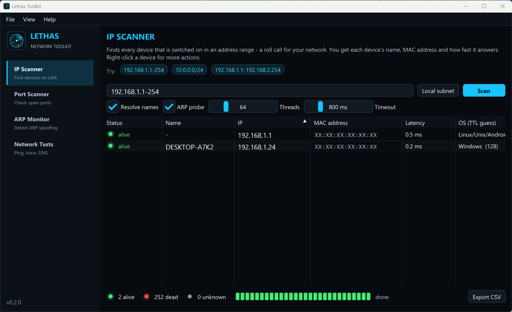
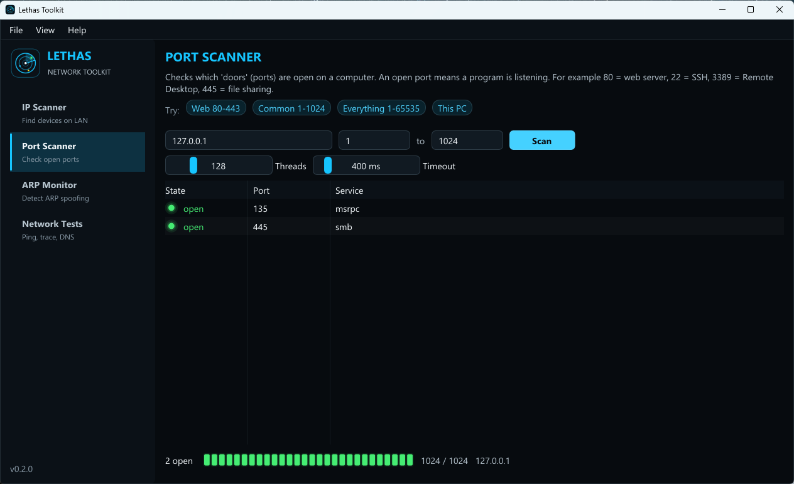
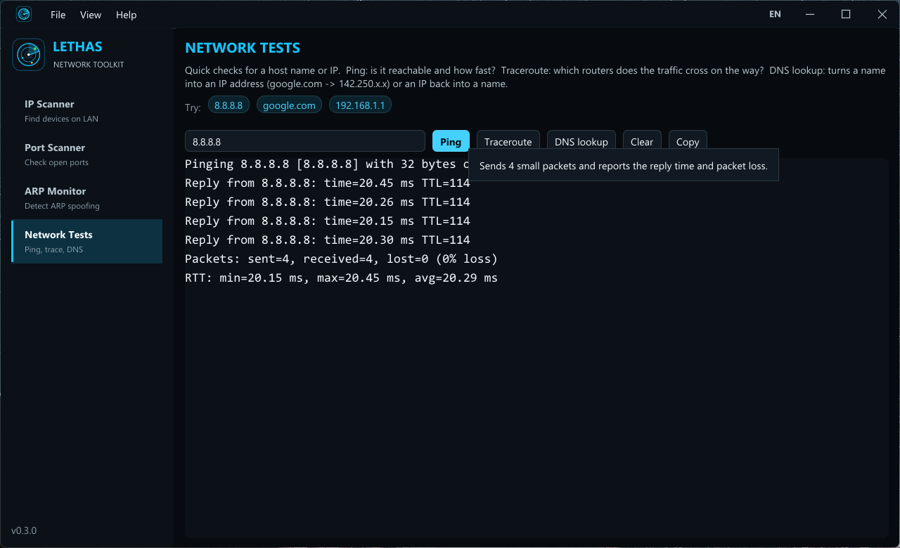
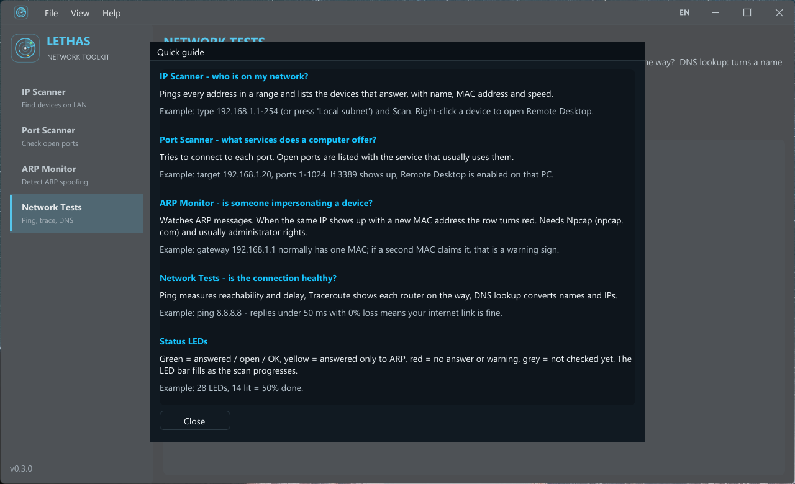

<p align="center">
  
</p>

<p align="center">
  <a href="https://github.com/mMobiusStrip/lethas-toolkit/actions/workflows/build.yml"></a>
  
  
  
</p>

**Lethas Toolkit**, Windows için C++20 ile yazılmış, tek `.exe` olarak çalışan hafif bir ağ analiz ve tanılama aracıdır. Önceki Python/CustomTkinter sürümünün yeniden yazılmış ve geliştirilmiş halidir.



<details>
<summary>Diğer ekranlar</summary>





</details>

> Gizlilik için ekran görüntülerindeki IP adresleri, cihaz adı ve MAC adresleri örnek/maskeli değerlerle değiştirilmiştir.

## Özellikler

| Araç | Ne işe yarar? | Örnek |
|---|---|---|
| **IP Scanner** | Bir adres aralığındaki canlı cihazları bulur; ad, MAC, gecikme ve TTL'den işletim sistemi tahmini gösterir. | `192.168.1.1-254` veya `10.0.0.0/24` |
| **Port Scanner** | Bir bilgisayarda hangi TCP portlarının açık olduğunu bulur. | `192.168.1.20`, port `1-1024` → `3389` açıksa Uzak Masaüstü etkin |
| **ARP Monitor** | ARP trafiğini canlı izler; aynı IP farklı MAC ile görünürse satırı kırmızıya boyar (ARP spoofing şüphesi). | Ağ geçidi `192.168.1.1` için ikinci bir MAC |
| **Network Tests** | Ping, Traceroute ve DNS sorgusu. | `ping 8.8.8.8`, `traceroute google.com` |

Python sürümüne göre yenilikler:

- Çok iş parçacıklı tarama, arayüz tarama sırasında donmaz
- Aralık girişi: `a.b.c.d-N`, tam aralık veya CIDR; **Local subnet** ile otomatik
- Ping'e yanıt vermeyen cihazlar ARP ile de yakalanır (**ARP only**)
- Ping, traceroute ve MAC okuma için dış süreç çalıştırmaz (`IcmpSendEcho`, `SendARP`)
- ARP izleme gerçekten durdurulabilir, hem istek hem yanıtları görür
- Sağ tık menüsü: ping, traceroute, port tarama, paylaşım klasörü, RDP, tarayıcı, IP/MAC kopyala
- Tmog tarzı LED ilerleme çubukları, 5 renk teması, CSV dışa aktarma
- Her ayarda açıklayıcı ipuçları (tooltip) ve **Help → Quick guide**

## İndirme

[Releases](https://github.com/mMobiusStrip/lethas-toolkit/releases) sayfasından `LethasToolkit.exe` dosyasını indirip çalıştırın. Kurulum gerekmez.

> **ARP Monitor** için [Npcap](https://npcap.com) kurulu olmalı ve program yönetici olarak çalıştırılmalıdır. Diğer araçlar Npcap olmadan çalışır.

## Kaynaktan derleme

Gereksinimler: Visual Studio 2022 (veya Build Tools, "Desktop development with C++") ve CMake 3.20+. Dear ImGui derleme sırasında otomatik indirilir.

```powershell
cmake -S . -B build -A x64
cmake --build build --config Release
.\build\Release\LethasToolkit.exe
```

Arayüzsüz çekirdek için duman testi:

```powershell
.\build\Release\core_smoke.exe
```

## Proje yapısı

```
src/core/   arayüzden bağımsız çekirdek (icmp, port/ip tarayıcı, arp, testler)
src/ui/     Dear ImGui arayüzü (tema, sayfalar, LED bileşenleri)
src/main.cpp  Win32 + Direct3D 11 kabuğu
resources/  uygulama ikonu
docs/       logo ve ekran görüntüleri
tests/      çekirdek duman testi
```

## Tasarım

Renk paleti [tmog.org](https://tmog.org) koyu temasından, yerleşim [Advanced IP Scanner](https://www.advanced-ip-scanner.com/)'dan esinlenmiştir.

## Sorumlu kullanım

Bu araç yalnızca **sahibi olduğunuz veya test etme izniniz olan** ağlarda kullanılmalıdır.

## Eski Python sürümü

İlk Python/CustomTkinter sürümü [`legacy-python/`](legacy-python/) altında korunmaktadır.

## Lisans

[MIT](LICENSE)
